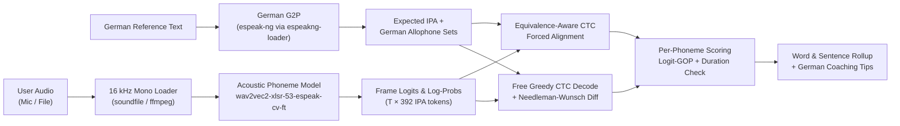

# German Aussprache Lab (`german-aussprachen`)

[](LICENSE)
[](pyproject.toml)
[](#architecture)

An open-source, fully local **German pronunciation assessment engine, web studio, and CLI**. It scores spoken German down to the individual **IPA phoneme**—diagnosing concrete sound substitutions (*"you said `/ʃ/` instead of `/ç/`"*), dropped sounds, and German vowel-length errors (*Staat* vs. *Stadt*)—without cloud API keys or a word-level language model silently auto-correcting mistakes.

---

## Why Not Standard Speech-to-Text?

General-purpose ASR models (Whisper, Google STT, etc.) rely on a strong word-level language model whose job is to guess the most plausible word. If a learner says *"Hutte"* (`/hʊtə/`) when trying to say *"Hütte"* (`/hʏtə/`), or *"isch"* (`/ɪʃ/`) instead of *"ich"* (`/ɪç/`), a standard transcriber quietly corrects it into the expected German word—great for transcription, useless for pronunciation coaching.

**German Aussprache Lab** removes the word-level language model entirely. Given a known target German sentence, it aligns your audio directly against canonical IPA phonemes using a CTC phoneme acoustic model (`facebook/wav2vec2-xlsr-53-espeak-cv-ft`), computes **Logit-margin Goodness of Pronunciation (Logit-GOP)** per phoneme, cross-checks against **free greedy phoneme decoding**, and measures **speaker-adaptive vowel duration**.

---

## Features

- **Phoneme-level IPA diagnostics**: Highlights every German word and phoneme (`good` / `fair` / `error` / `omitted`) with exact `expected → heard` IPA diagnoses and articulation tips.
- **No silent auto-correction**: Uses a multilingual acoustic phoneme recognizer (392 IPA tokens) with no word-level LM.
- **German-aware allophone tolerance**: Accepts valid regional German variants (`/ʁ/ ~ /r/ ~ /ɾ/`, vocalized `-er` `/ɐ/`, Northern German initial `/pf/ ~ /f/`, `ɔʏ/oɪ` transcription variants) while remaining strict on real learner errors (`/ç/` vs. `/ʃ/`, `/ʏ/` vs. `/ʊ/`/`/ɪ/`, `/x/` vs. `/k/`).
- **German vowel-length checking**: Speaker-adaptive duration checks catch long/short vowel swaps (e.g. *Staat* `/aː/` vs. *Stadt* `/a/`), while exempting unstressed function words (*der, den, wir*) and pre-rhotic reductions.
- **Omission & insertion detection**: Combines equivalence-aware CTC forced alignment with Needleman-Wunsch alignment over free greedy CTC output.
- **Interactive local Web UI**:
  - Browser microphone recording with live audio level meter (`.webm`/`.ogg`/`.mp3`/`.wav`/`.m4a` decoded via `soundfile` + `ffmpeg`).
  - Curated German practice presets with native reference audio playback, plus custom German sentence input.
  - **Click-to-replay**: Click any word or individual IPA phoneme tile to replay that exact `[start_s, end_s]` slice of your recording.
  - 8 built-in 1-click test clips (native German vs. deliberate learner mistakes) for instant evaluation without a microphone.
- **Rich CLI & REST API**: Scriptable terminal output (formatted tables or `--json`) and a FastAPI backend ready for integration.
- **Zero system G2P setup**: Bundles `libespeak-ng` via `espeakng-loader` and runs on CPU (~0.4–0.6s per sentence after model load).

---

## Architecture



### Scoring Pipeline Details

1. **German G2P & Vocab Mapping** ([`phonetics.py`](src/german_aussprachen/phonetics.py))
   - Converts each word to canonical German IPA via `espeak-ng` (`phonemizer`), applying targeted overrides for known espeak quirks (e.g. *Vögel* `/f/` instead of `/v/`).
   - Maps `espeak-ng` out-of-vocabulary symbols (notably short *ü* `ʏ → y`) into the model's 392-token vocabulary while preserving authentic German IPA (`ʏ`, `aː`, `ɔʏ`, `ʁ`, `ɐ`) for display.
2. **Equivalence-Aware CTC Forced Alignment** ([`aligner.py`](src/german_aussprachen/aligner.py))
   - Constructs a position-indexed emission matrix using `logsumexp` over each phoneme's acceptable German allophone set, then runs `torchaudio.functional.forced_align`.
   - Position-indexed columns keep identical adjacent phonemes across word boundaries cleanly separated and prevent alignment drift when the multilingual model prefers a transcription equivalent (such as `oɪ` for `ɔø` or `a` for `ɑː`).
3. **Logit-Margin GOP + Free CTC Check + Vowel Duration** ([`scorer.py`](src/german_aussprachen/scorer.py))
   - **Logit-GOP**: Computed over peak non-blank CTC frames within each phoneme's active emission window:
     $$\text{Logit-GOP}(p) = \sum_{t \in \text{peak}(p)} w_t \left(\max_{k \in E(p)} z_{t,k} - \max_{k \neq \text{blank}} z_{t,k}\right)$$
     where $E(p)$ is the acceptable token set for phoneme $p$ and $z_{t,k}$ is the frame logit. A value of `0.0` means the target (or a valid German allophone) won; strongly negative values indicate a competing sound won and identify what was heard.
   - **Completeness (Free CTC Diff)**: Greedy CTC decoding aligned with Needleman-Wunsch catches skipped words and dropped/inserted phonemes that forced alignment alone can smear across silence.
   - **Vowel Length**: Measures aligned durations relative to the speaker's own median vowel pace on stressed content words, catching *too short* long vowels and *too long* short vowels.

### German Phonetic Design Choices

| Category | Expected IPA | Tolerated Variants | Strictly Flagged Learner Confusions |
|---|---|---|---|
| **Ich-Laut** | `/ç/` | `{ç, ɕ}` | `/ʃ/` (*isch*), `/k/`, `/x/`, `/s/`, `/tʃ/` |
| **Ach-Laut** | `/x/` | `{x, χ}` | `/k/` (*Back*), `/h/`, `/ç/`, `/ʃ/` |
| **Short / Long Ü** | `/ʏ/`, `/yː/` | `{y, yː}` (length checked separately) | `/ʊ/`, `/u/`, `/uː/` (*Hutte*), `/ɪ/`, `/i/`, `/ʌ/` |
| **Short / Long Ö** | `/œ/`, `/øː/` | `{œ, ø, øː}` | `/o/`, `/ɔ/`, `/oː/`, `/uː/`, unrounded `/ɛ/` |
| **Long vs. Short A** | `/aː/` vs. `/a/` | Quality `{a, ɑ, aː, ɑː}` + duration check | *Staat* too short, *Stadt* too long |
| **German R / `-er`** | `/ʁ/`, `/ɐ/` | `{ɾ, r, ʁ, ɐ, ɜ}` | Omission in onset; English retroflex drift |
| **Diphthong `eu/äu`** | `/ɔʏ/` | `{ɔø, ɔɪ, oɪ, øi}` | `/aʊ/`, `/aɪ/` |
| **Initial `pf-`** | `/pf/` | `{pf, f}` (Northern/Central German variant) | Medial `p+f` (*Äpfel*) scored separately |

---

## Empirical Calibration Results

Evaluated on the 14 included test clips (`samples/`, reproducible via `uv run pytest -v`):

| Test Clip | Reference Sentence | Overall | Accuracy | Completeness | Vowel Length | Flagged Issues |
|---|---|---:|---:|---:|---:|---|
| Native German (6 presets: *Hütte*, *Staat/Stadt*, *Bücher*, *Bach*, *Küche*, *Deutsch*) | *(matching)* | **98.8–100.0** | 98.3–100.0 | 100.0 | 100.0 | None (0 false alarms) |
| Learner error: *"Isch möschte ... Hutte"* | *Ich möchte eine Hütte mieten.* | **87.4** | 93.5 | 100.0 | 100.0 | `Ich /ç/ → /ʃ/` (error), `Hütte /ʏ/ → /ʊ/` (error) |
| Learner error: Swapped *Staat* / *Stadt* | *Der Staat baut eine neue Stadt.* | **80.9** | 95.5 | 100.0 | 0.0 | `Staat /aː/` too short, `Stadt /a/` too long |
| Learner error: *"Back"* instead of *"Bach"* | *Zwölf große Pferde springen über den Bach.* | **87.1** | 92.9 | 100.0 | 100.0 | `Bach /x/ → /k/` (error), `Bach /a/ → /ɛ/` (error) |
| Incomplete: Dropped *"eine Hütte"* | *Ich möchte eine Hütte mieten.* | **63.7** | 60.2 | 57.9 | 100.0 | `eine` & `Hütte` marked `omitted` |
| English phonology reading German | *Ich möchte eine Hütte mieten.* | **53.6** | 66.7 | 84.2 | 100.0 | `Hütte /ʏ/→/ʌ/`, `möchte /ç/→/k/`, `mieten /iː/→/aɪ/`, `Ich /ç/→/tʃ/` |

---

## Quick Start

### Prerequisites

- **Python 3.11 or 3.12** and [`uv`](https://docs.astral.sh/uv/)
- **`ffmpeg`** on `PATH` (required for browser `.webm`/`.ogg`/`.mp3`/`.m4a` decoding; `.wav` works directly via `soundfile`)
- ~1.3 GB disk space for the Hugging Face model cache (`facebook/wav2vec2-xlsr-53-espeak-cv-ft`, downloaded automatically on first run and cached locally for offline use)

### Installation

```bash
git clone https://github.com/PabloMoralesEscandon/german-aussprachen.git
cd german-aussprachen
uv sync --python 3.12 --extra dev
```

*(By default, `pyproject.toml` pulls the lightweight CPU wheels for PyTorch and torchaudio.)*

### 1. Launch the Web Demo

```bash
uv run aussprache serve --host 127.0.0.1 --port 8000
```

Open **http://127.0.0.1:8000** in your browser. You can:
- Select any of the 6 practice presets or type an arbitrary German sentence.
- Listen to native reference audio, record from your microphone, upload an audio file, or click any built-in sample clip.
- Click any word pill or IPA phoneme tile to replay that segment and inspect its Logit-GOP, Posterior-GOP, confidence, duration, and German articulation tip.

### 2. Run from the CLI

```bash
# Score an audio recording against a German sentence
uv run aussprache analyze samples/huette_isch_hut.wav "Ich möchte eine Hütte mieten."

# Show the full per-phoneme table (Logit-GOP, duration, free-decode op)
uv run aussprache analyze samples/huette_isch_hut.wav "Ich möchte eine Hütte mieten." --verbose

# Export structured JSON
uv run aussprache analyze samples/staat_swapped.wav "Der Staat baut eine neue Stadt." --json

# List all practice presets and built-in test clips
uv run aussprache presets
```

### 3. Run Tests & Regenerate Demo Samples

```bash
# Run the full test suite (G2P, error detection, vowel duration, FastAPI endpoints)
uv run pytest -v

# Optional: regenerate the 14 WAV files in samples/ using edge-tts
uv run python scripts/generate_samples.py
```

---

## HTTP API Reference

When running `uv run aussprache serve`, the FastAPI server exposes:

| Method | Endpoint | Description |
|---|---|---|
| `GET` | `/` | Interactive single-page web UI |
| `GET` | `/api/health` | Model load state (`loading` / `ready` / `error`), model ID, and device |
| `GET` | `/api/presets` | Curated German practice sentences and native reference audio URLs |
| `GET` | `/api/samples` | Metadata and audio URLs for built-in test clips |
| `POST` | `/api/analyze` | Multipart upload (`audio` file + `reference_text` form field) → full JSON assessment |
| `POST` | `/api/analyze-sample/{sample_id}` | Runs assessment on a built-in clip (optional `reference_text` override) |

Example `curl` call:

```bash
curl -X POST http://127.0.0.1:8000/api/analyze \
  -F 'reference_text=Ich möchte eine Hütte mieten.' \
  -F 'audio=@samples/huette_isch_hut.wav'
```

---

## Project Layout

```text
german-aussprachen/
├── LICENSE
├── README.md
├── pyproject.toml
├── uv.lock
├── samples/                         # 8 test clips (native + learner errors) + 6 preset reference clips
├── scripts/
│   └── generate_samples.py          # Reproducible demo & reference audio generator (edge-tts)
├── src/german_aussprachen/
│   ├── __init__.py
│   ├── phonetics.py                 # German G2P (espeak-ng), OOV mapping, allophone sets, coaching tips
│   ├── audio.py                     # 16 kHz mono decoding (soundfile + ffmpeg fallback)
│   ├── aligner.py                   # Equivalence-aware CTC forced alignment + Needleman-Wunsch diff
│   ├── scorer.py                    # wav2vec2 inference, Logit-GOP, vowel length, word/sentence rollup
│   ├── presets.py                   # Curated German practice sentences and demo clip definitions
│   ├── cli.py                       # Typer + Rich CLI (`aussprache analyze | serve | presets`)
│   └── web/
│       ├── app.py                   # FastAPI application
│       └── static/index.html        # Zero-build single-page web demo UI
└── tests/
    └── test_engine.py               # Automated end-to-end engine and API tests
```

---

## Limitations & Roadmap

This is a practical open-source baseline rather than a replacement for a human phonetician. Known limitations:

- **Multilingual model fuzziness**: `wav2vec2-xlsr-53-espeak-cv-ft` splits capacity across 53 languages, so subtle vowel boundaries (e.g. mildly under-rounded `/œ/` drifting toward `/ɛ/`) are less crisp than a dedicated German-only phoneme model.
- **No prosody or lexical stress yet**: The engine evaluates segmental phoneme accuracy, completeness, and vowel duration, not pitch contour or syllable stress (*ÚMfahren* vs. *umfáhren*).
- **Threshold calibration**: Currently calibrated on native + synthetic learner errors; calibrating against human-annotated L2 German recordings (or benchmarking against commercial baselines) will improve absolute 0–100 score linearity.

Potential next directions:
- Fine-tune a compact **German-only phoneme encoder** (e.g. `wav2vec2-base` or `FastConformer` on German Common Voice) for sharper umlaut boundaries and <100 MB INT8 mobile deployment.
- Export to **ONNX Runtime (INT8)** for offline iOS/Android use.
- Add pitch/energy-based **word-stress checking** and a **minimal-pair drill mode** (*Hüte/Hütte*, *Staat/Stadt*, *Küche/Kuchen*).

---

## License & Third-Party Notices

This repository's source code is licensed under the **Apache License 2.0** — see [LICENSE](LICENSE) for full terms.

Third-party models and runtime components remain subject to their respective licenses:
- **`facebook/wav2vec2-xlsr-53-espeak-cv-ft`**: Downloaded at runtime from Hugging Face Hub; review its [model card and license](https://huggingface.co/facebook/wav2vec2-xlsr-53-espeak-cv-ft) before commercial redistribution.
- **`espeak-ng` / `espeakng-loader`**: Loaded at runtime as a dynamic library (`GPL-3.0`); review compatibility if bundling into closed-source distributions.
